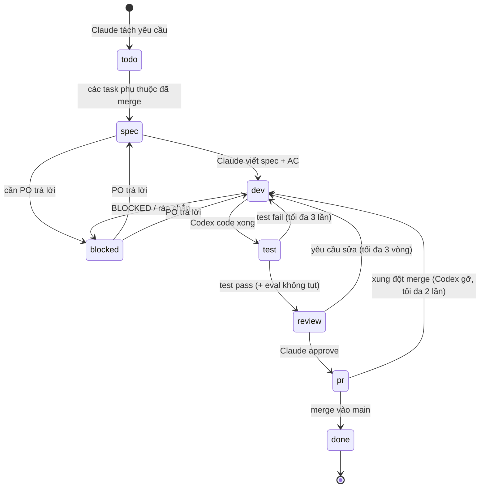
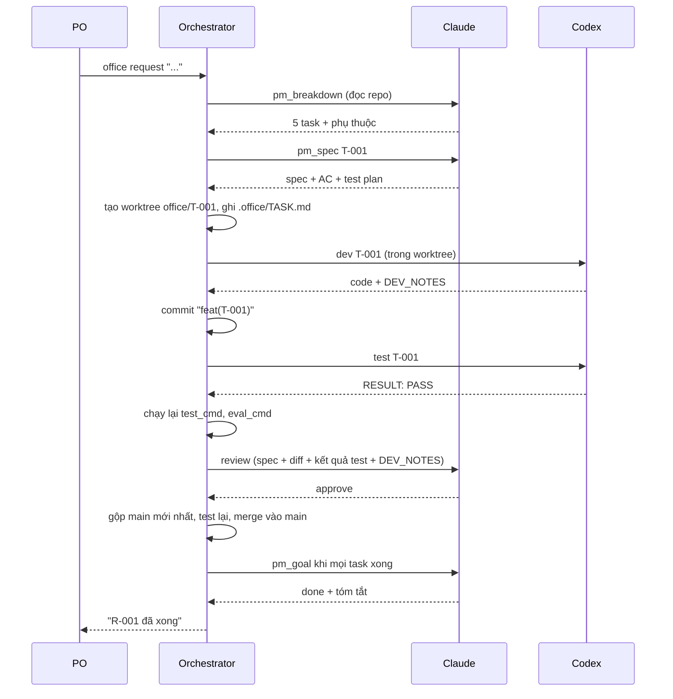

# 1. Kiến trúc multi-agent và cách các agent giao việc cho nhau

## 1.1 Vai trò

| Vai | Ai làm | Được làm gì | Không được làm gì |
|---|---|---|---|
| Product Owner | Hoang | Đưa yêu cầu, trả lời câu hỏi, đặt mục tiêu chất lượng | Không cần đọc code |
| Product Manager | Claude | Tách yêu cầu thành task, viết spec + acceptance criteria (AC), kiểm tra mục tiêu cuối | Không sửa file |
| Tech Lead / Reviewer | Claude | Review diff theo spec, approve hoặc yêu cầu sửa | Không sửa file |
| Developer | Codex | Code theo spec trong worktree riêng của task | Không commit, push, đổi nhánh |
| Tester | Codex | Bổ sung test cho mọi AC, chạy test, viết báo cáo | Không đổi phạm vi task |
| Orchestrator | Chương trình `office` (Python) | Lập lịch, gọi agent, commit, chạy test, merge, lưu trạng thái | Không tự "nghĩ": mọi quyết định nội dung là của agent |

Vì sao hai hãng khác nhau: Claude mạnh ở đọc hiểu, lập kế hoạch, review; Codex mạnh ở viết và sửa
code trong sandbox. Người review khác người viết code giúp bắt lỗi tốt hơn (giống "four-eyes
principle"), và hai gói thuê bao có hai hạn mức quota riêng, nên khi một bên nghỉ bên kia vẫn làm.

Điểm quan trọng nhất của thiết kế: **agent không nói chuyện trực tiếp với nhau**. Chúng giao việc
qua **orchestrator** và **file**. Orchestrator là code thường, có thể test, nên luồng công việc
không phụ thuộc vào việc một mô hình nhớ đúng quy trình.

## 1.2 Gọi agent không cần API key

```text
claude -p --output-format json --allowedTools Read Grep Glob "Bash(git diff:*)" ...   (prompt qua stdin)
codex exec --json --sandbox workspace-write --skip-git-repo-check -C <worktree> --output-last-message <file> -
```

- `claude -p` là chế độ headless của Claude Code, dùng phiên đăng nhập `/login` (Pro/Max).
  `--allowedTools` giới hạn Claude chỉ đọc repo, kể cả khi review.
- `codex exec` là chế độ không tương tác của Codex CLI, dùng `codex login` bằng tài khoản ChatGPT.
  `--sandbox workspace-write` cho phép ghi trong worktree, không ra ngoài.
- Trước khi chạy, orchestrator **xóa `ANTHROPIC_API_KEY`, `OPENAI_API_KEY`** khỏi môi trường của
  tiến trình con (`subscription_env()`), để CLI chắc chắn dùng gói thuê bao chứ không tính tiền API.
- Mỗi lần gọi có timeout (Claude 30 phút, Codex 60 phút) và log đầy đủ ở
  `.agent-office/logs/<task>/<n>-<bước>-<agent>.log`.

## 1.3 Prompt là hợp đồng, đầu ra là JSON

Mỗi vai có một file prompt trong `agent-office/agent_office/prompts/`:

| Prompt | Vai | Đầu ra bắt buộc |
|---|---|---|
| `pm_breakdown.md` | Claude chia việc | `{"tasks":[{"key","title","brief","depends_on"}]}` hoặc `{"questions":[...]}` |
| `pm_spec.md` | Claude viết spec | `{"spec","acceptance_criteria","test_plan","out_of_scope"}` hoặc `{"questions"}` |
| `dev.md` | Codex code | Văn bản tóm tắt; bắt đầu bằng `BLOCKED:` nếu bị chặn |
| `test.md` | Codex test | Dòng cuối `RESULT: PASS` hoặc `RESULT: FAIL` |
| `review.md` | Claude review | `{"verdict":"approve|changes","summary","comments":[{file,line,severity,text}]}` |
| `pm_goal.md` | Claude kiểm tra mục tiêu | `{"done":true,"summary"}` hoặc thêm task bổ sung |

Kỹ thuật dùng:

- **Structured output bằng JSON** + bộ đọc chịu lỗi (`extract_json`): lấy khối JSON trong
  ```` ```json ```` hoặc object `{...}` đầu tiên, nên mô hình lỡ viết thêm chữ vẫn đọc được.
  Không đọc được thì task chuyển `blocked` thay vì đoán.
- **"Ask only if truly unclear"**: prompt PM liệt kê rõ khi nào được tự quyết (công nghệ, cấu
  trúc file, giá trị mặc định, ghi lại thành "Assumptions") và khi nào mới hỏi PO.
- **Ngữ cảnh qua file, không qua hội thoại**: spec, AC, phản hồi review, log test lỗi được ghi vào
  `.office/TASK.md` trong worktree. Agent luôn đọc trạng thái mới nhất, không cần nhớ phiên trước.

## 1.4 Vòng đời một task (state machine)



- Chuyển trạng thái chỉ hợp lệ theo bảng `TRANSITIONS` trong `models.py`; sai là lỗi ngay.
- Mỗi lần chuyển ghi vào `task.history` và sự kiện `stage_changed` trong `events.jsonl`.
- Giới hạn vòng lặp (`MAX_TEST_ATTEMPTS`, `MAX_REVIEW_ROUNDS`, `MAX_CONFLICT_ROUNDS`) chặn agent
  lặp vô hạn; hết lượt thì `blocked` và báo PO.

## 1.5 Giao việc (handoff) diễn ra thế nào



Orchestrator **không tin lời agent một mình**: sau khi Codex báo pass, nó tự chạy `test_cmd` và
`eval_cmd`; sau khi Claude approve, nó tự kiểm tra xung đột và test lại trước khi merge.

Mỗi bước còn phát một sự kiện `message` (người gửi, người nhận, nội dung tiếng Việt) để giao diện
hiển thị như một cuộc hội thoại: "Claude → Codex: Giao T-002...", "Codex → Claude: T-002 test pass,
nhờ review", "Claude → PO: Đã merge T-002".

## 1.6 Lập lịch (scheduler)

`scheduler.plan_steps()` là một hàm thuần (dễ test) trả về mọi bước có thể chạy ngay:

1. Agent hết giờ nghỉ được **đánh thức** trước (một prompt "probe" rất nhỏ để chắc đã có quota).
2. Yêu cầu mới cần chia việc; yêu cầu có mọi task xong cần kiểm tra mục tiêu.
3. Task theo thứ tự ưu tiên **làm nốt việc dở trước**: `pr > review > test > dev > spec > todo`.
4. Bỏ qua task chưa đủ phụ thuộc, task `blocked`, agent đang nghỉ, agent hết phiên trống.

Hàm trả kèm danh sách lý do đang chờ ("T-005 waits for T-003, T-004 to be merged",
"codex resting until 19:15") để CLI và dashboard giải thích vì sao đứng yên.

## 1.7 Git worktree: mỗi task một bàn làm việc

- `git worktree add ../<repo>-worktrees/T-002 -b office/T-002 main`: thư mục riêng, nhánh riêng,
  dùng chung lịch sử git. Hai task code song song không giẫm chân nhau.
- `.office/` trong worktree chứa `TASK.md`, `CHECKPOINT.md`, `DEV_NOTES.md`, `TEST_REPORT.md`,
  `REVIEW-n.md`; thư mục này nằm trong `.git/info/exclude` nên không bao giờ bị commit.
- Orchestrator commit thay agent (`feat(T-002): ...`, `test(T-002): ...`), nên lịch sử sạch và
  agent không thể push nhầm.
- Merge xong thì worktree bị xóa.

## 1.8 Tự chủ hoàn toàn, chỉ hỏi khi chưa rõ

- `merge_mode = "auto"`: review đạt + test pass là tự merge (local fast-forward hoặc
  `gh pr merge --squash`), rồi làm tiếp task sau.
- Câu hỏi của Claude (ở bước chia việc, viết spec hoặc kiểm tra mục tiêu) chuyển yêu cầu/task
  sang `blocked`; **các task khác vẫn chạy**. PO trả lời trên dashboard/văn phòng 3D hoặc
  `office answer T-003 "..."`, câu trả lời được ghép vào prompt lần sau.
- **Kiểm tra mục tiêu (goal check)**: khi mọi task của một yêu cầu đã merge, Claude đọc lại repo
  so với yêu cầu gốc; thiếu thì tự lên task bổ sung (tối đa `max_goal_rounds`), đủ thì báo xong.

## 1.9 Trạng thái bền vững và lệnh từ bên ngoài

| File trong `.agent-office/` | Vai trò |
|---|---|
| `state.json` | Toàn bộ agent, yêu cầu, task; ghi nguyên tử (file tạm + `os.replace`) |
| `events.jsonl` | Nhật ký sự kiện chỉ ghi thêm: nguồn cho dashboard, thống kê, điều tra |
| `inbox.jsonl` | Lệnh từ CLI/dashboard khi runner đang chạy (yêu cầu mới, trả lời, đánh thức) |
| `runner.pid` | Khóa: chỉ một runner trên một repo |
| `logs/` | Log từng lần gọi agent |
| `config.toml` | Cấu hình |

Runner là nơi duy nhất ghi `state.json`. Mọi tác nhân khác **xếp lệnh vào inbox**; runner lấy
inbox một cách nguyên tử (đổi tên file) ở đầu mỗi vòng. Nhờ vậy không có hai tiến trình ghi đè
trạng thái của nhau, và không cần database.
