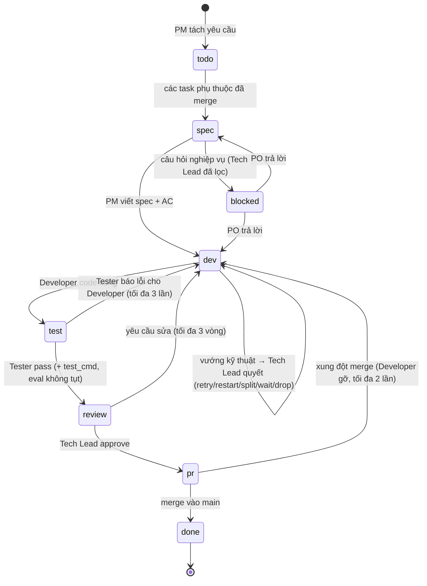
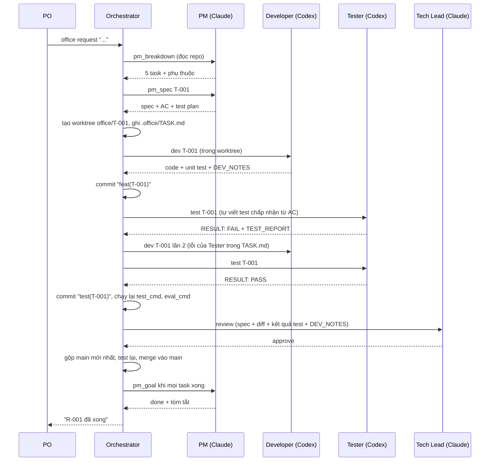

# 1. Kiến trúc multi-agent và cách các agent giao việc cho nhau

## 1.1 Vai trò

Mỗi vai là **một agent riêng** (tên `pm`, `lead`, `dev`, `tester`): trạng thái, prompt, log, số phiên
song song, bàn trong văn phòng 3D và thống kê riêng. Hai vai cùng chạy trên một CLI thì dùng chung
một gói thuê bao (xem 1.11).

| Vai (agent) | Chạy trên | Được làm gì | Không được làm gì |
|---|---|---|---|
| Product Owner | Hoang | Đưa yêu cầu, trả lời câu hỏi nghiệp vụ, đặt mục tiêu chất lượng | Không cần đọc code |
| Product Manager (`pm`) | Claude; `dev` (Codex) tiếp quản khi Claude hết quota | Tách yêu cầu thành task, viết spec + acceptance criteria (AC), kiểm tra mục tiêu cuối | Không sửa file |
| Tech Lead / Reviewer (`lead`) | Claude; `tester` (Codex) tiếp quản khi Claude hết quota | Review diff theo spec, approve hoặc yêu cầu sửa; quyết mọi blocker kỹ thuật, lọc câu hỏi (chỉ câu nghiệp vụ tới PO) | Không sửa file |
| Developer (`dev`) | Codex; `pm` (Claude) tiếp quản khi Codex hết quota | Code + unit test (TDD) theo spec trong worktree riêng của task | Không commit/push/đổi nhánh; không xóa, skip hay làm yếu test của Tester |
| Tester (`tester`) | Codex; `lead` (Claude) tiếp quản khi Codex hết quota | Tự viết test chấp nhận từ AC (không dựa vào test của Dev), kiểm tra test của Dev có thể fail, chạy toàn bộ, báo lỗi về Dev | Không sửa code sản phẩm, không đổi phạm vi |
| Orchestrator | Chương trình `office` (Python) | Lập lịch, gọi agent, commit, chạy test, merge, lưu trạng thái | Không tự "nghĩ": mọi quyết định nội dung là của agent |

Vì sao hai hãng khác nhau: Claude mạnh ở đọc hiểu, lập kế hoạch, review; Codex mạnh ở viết và sửa
code trong sandbox. Người review khác người viết code giúp bắt lỗi tốt hơn (giống "four-eyes
principle"), và hai gói thuê bao có hai hạn mức quota riêng, nên khi một bên nghỉ bên kia vẫn làm.

Điểm quan trọng nhất của thiết kế: **agent không nói chuyện trực tiếp với nhau**. Chúng giao việc
qua **orchestrator** và **file**. Orchestrator là code thường, có thể test, nên luồng công việc
không phụ thuộc vào việc một mô hình nhớ đúng quy trình.

## 1.2 Gọi agent không cần API key

```text
claude -p --output-format json --allowedTools Read Grep Glob "Bash(git diff:*)" ...   (prompt qua stdin)
codex exec --json --sandbox workspace-write --skip-git-repo-check -C <worktree> --output-last-message <file> -
```

- `claude -p` là chế độ headless của Claude Code, dùng phiên đăng nhập `/login` (Pro/Max).
  `--allowedTools` giới hạn Claude chỉ đọc repo, kể cả khi review.
- `codex exec` là chế độ không tương tác của Codex CLI, dùng `codex login` bằng tài khoản ChatGPT.
  `--sandbox workspace-write` cho phép ghi trong worktree, không ra ngoài.
- Trước khi chạy, orchestrator **xóa `ANTHROPIC_API_KEY`, `OPENAI_API_KEY`** khỏi môi trường của
  tiến trình con (`subscription_env()`), để CLI chắc chắn dùng gói thuê bao chứ không tính tiền API.
  Ngoại lệ duy nhất: biến `env_key` của provider Codex tự cấu hình (ví dụ `CODEX_LB_API_KEY` của
  proxy codex-lb), lấy từ shell hoặc `.agent-office/.env` (xem [2.8](02-quota-song-song-rao-chan.md#28-chạy-codex-qua-codex-lb-gộp-nhiều-tài-khoản-chatgpt)).
- Mỗi lần gọi có timeout (Claude 30 phút, Codex 60 phút) và log đầy đủ ở
  `.agent-office/logs/<task>/<n>-<bước>-<agent>.log`.

## 1.3 Prompt là hợp đồng, đầu ra là JSON

Mỗi vai có một file prompt trong `agent-office/agent_office/prompts/`:

| Prompt | Vai | Đầu ra bắt buộc |
|---|---|---|
| `pm_breakdown.md` | Claude chia việc | `{"tasks":[{"key","title","brief","depends_on"}]}` hoặc `{"questions":[...]}` |
| `pm_spec.md` | Claude viết spec | `{"spec","acceptance_criteria","test_plan","out_of_scope"}` hoặc `{"questions"}` |
| `dev.md` | Developer code | Văn bản tóm tắt; bắt đầu bằng `BLOCKED:` nếu bị chặn |
| `test.md` | Tester kiểm tra độc lập | `.office/TEST_REPORT.md` (mục "Failures for the Developer"); dòng cuối `RESULT: PASS` hoặc `RESULT: FAIL` |
| `review.md` | Tech Lead review | `{"verdict":"approve|changes","summary","comments":[{file,line,severity,text}]}` |
| `tech_lead.md` | Tech Lead gỡ blocker | `{"action":...}` hoặc `{"business_questions":[...]}` |
| `pm_goal.md` | PM kiểm tra mục tiêu | `{"done":true,"summary"}` hoặc thêm task bổ sung |

Kỹ thuật dùng:

- **Structured output bằng JSON** + bộ đọc chịu lỗi (`extract_json`): lấy khối JSON trong
  ```` ```json ```` hoặc object `{...}` đầu tiên, nên mô hình lỡ viết thêm chữ vẫn đọc được.
  Không đọc được thì Tech Lead xử lý (xem 1.10) thay vì đoán.
- **"Ask only if truly unclear"**: prompt PM liệt kê rõ khi nào được tự quyết (công nghệ, cấu
  trúc file, giá trị mặc định, thứ tự task, ghi lại thành "Assumptions") và chỉ hỏi khi
  **nghiệp vụ** chưa rõ. Câu hỏi còn phải qua Tech Lead phân loại (1.10).
- **Ngữ cảnh qua file, không qua hội thoại**: spec, AC, phản hồi review, log test lỗi được ghi vào
  `.office/TASK.md` trong worktree. Agent luôn đọc trạng thái mới nhất, không cần nhớ phiên trước.

## 1.4 Vòng đời một task (state machine)



- Chuyển trạng thái chỉ hợp lệ theo bảng `TRANSITIONS` trong `models.py`; sai là lỗi ngay.
- Mỗi lần chuyển ghi vào `task.history` và sự kiện `stage_changed` trong `events.jsonl`.
- Giới hạn vòng lặp (`MAX_TEST_ATTEMPTS`, `MAX_REVIEW_ROUNDS`, `MAX_CONFLICT_ROUNDS`) chặn agent
  lặp vô hạn; hết lượt thì task sang **Tech Lead** (1.10), không hỏi PO. `blocked` giờ chỉ còn nghĩa
  "chờ PO trả lời câu hỏi nghiệp vụ".

## 1.5 Giao việc (handoff) diễn ra thế nào



Orchestrator **không tin lời agent một mình**: Tester không tin test của Developer (tự viết test của
mình), sau khi Tester báo pass orchestrator tự chạy `test_cmd` và `eval_cmd`; sau khi Tech Lead
approve, nó tự kiểm tra xung đột và test lại trước khi merge.

Mỗi bước còn phát một sự kiện `message` (người gửi, người nhận là tên vai, nội dung tiếng Việt) để
giao diện hiển thị như một cuộc hội thoại: "PM → Developer: Giao T-002...", "Developer → Tester:
T-002 code xong", "Tester → Developer: T-002 test fail..." hoặc "Tester → Tech Lead: T-002 test pass",
"Tech Lead → PO: Đã merge T-002".

## 1.6 Lập lịch (scheduler)

`scheduler.plan_steps()` là một hàm thuần (dễ test) trả về mọi bước có thể chạy ngay:

1. CLI hết giờ nghỉ được **đánh thức** trước: một prompt "probe" rất nhỏ cho cả CLI, đạt thì mọi vai
   trên CLI đó làm lại.
2. Yêu cầu mới cần chia việc; yêu cầu có mọi task xong cần kiểm tra mục tiêu.
3. Task theo thứ tự ưu tiên **làm nốt việc dở trước**: `pr > review > test > dev > spec > todo`.
4. Bỏ qua task chưa đủ phụ thuộc, task `blocked`, vai đang nghỉ, vai hết phiên trống (`[parallel]`
   tính riêng từng vai).

Hàm trả kèm danh sách lý do đang chờ ("T-005 waits for T-003, T-004 to be merged",
"codex resting until 19:15 (roles dev, tester; quota: ...)") để CLI và dashboard giải thích vì sao
đứng yên.

## 1.7 Git worktree: mỗi task một bàn làm việc

- `git worktree add ../<repo>-worktrees/T-002 -b office/T-002 main`: thư mục riêng, nhánh riêng,
  dùng chung lịch sử git. Hai task code song song không giẫm chân nhau.
- `.office/` trong worktree chứa `TASK.md`, `CHECKPOINT.md`, `DEV_NOTES.md`, `TEST_REPORT.md`,
  `REVIEW-n.md`; thư mục này nằm trong `.git/info/exclude` nên không bao giờ bị commit.
- Orchestrator commit thay agent (`feat(T-002): ...`, `test(T-002): ...`), nên lịch sử sạch và
  agent không thể push nhầm.
- Merge xong thì worktree bị xóa.

## 1.8 Tự chủ hoàn toàn, chỉ hỏi khi chưa rõ

- `merge_mode = "auto"`: review đạt + test pass là tự merge (local fast-forward hoặc
  `gh pr merge --squash`), rồi làm tiếp task sau.
- Câu hỏi của Claude (ở bước chia việc, viết spec hoặc kiểm tra mục tiêu) đi qua Tech Lead trước.
  Chỉ câu hỏi **nghiệp vụ** mới chuyển yêu cầu/task sang `blocked`; **các task khác vẫn chạy**. PO trả
  lời trên dashboard/văn phòng 3D hoặc `office answer T-003 "..."`, câu trả lời được ghép vào prompt
  lần sau.
- **Kiểm tra mục tiêu (goal check)**: khi mọi task của một yêu cầu đã merge, Claude đọc lại repo
  so với yêu cầu gốc; thiếu thì tự lên task bổ sung (tối đa `max_goal_rounds`), đủ thì báo xong.
  Hết số vòng thì yêu cầu được đóng với phần đã merge và một **báo cáo** phần còn thiếu (không hỏi).

## 1.10 Ai quyết gì: PO chỉ gửi yêu cầu, PM + Tech Lead gỡ mọi blocker kỹ thuật

PO chỉ gửi yêu cầu. Mọi chuyện kỹ thuật và điều phối để các task không chặn nhau là việc của PM và
Tech Lead (Claude). PO chỉ được hỏi khi **nghiệp vụ** chưa rõ.

**Phân loại.** Mọi chỗ trước đây hỏi PO giờ gọi `_escalate` (task) hoặc `_escalate_request` (yêu
cầu): ghi `tl_issue`, `tl_kind` và bước kế tiếp của task là bước `techlead` của Claude (ưu tiên trước
việc mới). Prompt `prompts/tech_lead.md` bắt Claude phân loại trước:

- **Nghiệp vụ**: chỉ PO biết, đổi điều sản phẩm làm cho người dùng, không suy ra được từ yêu cầu,
  repo hay `docs/superpowers/` (giải đấu nào, ai là người dùng, quy tắc sản phẩm có nhiều đáp án).
  Trả `{"business_questions": [...]}` → task/yêu cầu `blocked`, PO trả lời như cũ.
- **Kỹ thuật**: mọi thứ còn lại. Claude tự quyết và trả một hành động:

| Hành động | Khi nào | Office làm gì |
|---|---|---|
| `retry` | Trả lời câu hỏi kỹ thuật, đổi cách làm, phân xử review, cách sửa test | Chạy lại bước bị kẹt với `guidance` (prompt dev mục `TECH LEAD DECISION`, `TASK.md` mục "Tech Lead decisions"); có thể thay spec/AC/files; reset bộ đếm test/review/xung đột |
| `restart` | Nhánh xung đột mãi hoặc đi sai hướng | Bỏ worktree, cắt nhánh mới `office/T-xxx-r2` từ `main` mới nhất; `after: ["T-002"]` để chờ task kia merge trước |
| `split` | Diff quá lớn, task ôm nhiều việc | Tạo task nhỏ hơn; task phụ thuộc task cũ giờ chờ các task mới; task cũ đóng (không merge) |
| `wait` | Nguyên nhân bên ngoài (GitHub/mạng) | Không chạy task tới `retry_at`, rồi thử lại |
| `drop` | Task không cần / không làm được | Đóng task (không merge), báo cáo PO; goal check lên kế hoạch lại phần thiếu |

**Các chỗ đã chuyển từ PO sang Tech Lead** (`tl_kind`): câu hỏi của PM (`questions`), output không
đọc được (`parse_error`), Codex trả `BLOCKED:` (`dev_blocked`), thiếu dependency sau `dep_retries`
(`missing_dependency`), lỗi git (`git_error`), xung đột merge sau `MAX_CONFLICT_ROUNDS` hoặc còn marker
(`merge_conflict`), merge PR lỗi (`merge_failed`), test fail 3 lần (`tests_failing`), review 3 vòng chưa
đạt (`review_rejected`), rào chắn `secret` / `protected_paths` / `diff_size`.

**Rào chắn không bao giờ được bỏ qua**, chỉ được sửa: prompt cấm xin nâng giới hạn, bỏ test hay
"merge luôn". Với `secret`, mọi `retry` đều thành `restart` và nhánh cũ bị **xóa**, nên secret không
bao giờ vào lịch sử git. Rào chắn được kiểm tra lại sau mỗi lần dev.

**Giới hạn để không lặp vô hạn.** `[office] tech_lead_rounds = 3` quyết định mỗi task. Hết lượt thì
task được gác lại (`dropped`, không merge) và PO nhận một **báo cáo** (không phải câu hỏi); goal check
sẽ lên task mới cho phần còn thiếu. Ở cấp yêu cầu (không thể gác lại), hết lượt thì **tạm dừng 60
phút** rồi thử lại. Giới hạn hệ thống (quota, `max_calls_per_day`) vẫn là nghỉ và tự làm lại.

**State cũ (trước khi có Tech Lead).** Mỗi lần office khởi động (bước đầu tiên của `office run`,
nút "Bắt đầu" trên dashboard) và khi chạy `office triage`, hàm `triage()` quét các task/yêu cầu đang
`blocked` chờ PO. Cái nào **chưa** được Tech Lead lọc (lý do không bắt đầu bằng
`business question for the PO`) được trả về đúng stage cũ và giao Tech Lead với `tl_kind` đoán từ lý
do (`tests still failing` → `tests_failing`, `PM needs answers` → `questions`, ...). Câu nghiệp vụ đã lọc
vẫn chờ PO; yêu cầu bị chặn vì hết `max_goal_rounds` được đóng kèm báo cáo.

**Ghi quyết định.** Mỗi quyết định thêm một dòng `Tech Lead (<kind>): ...` vào `task.decisions` (hoặc
`req.decisions`), được ghi vào `docs/superpowers/DECISIONS.md` ở lần commit kế tiếp (ghi thêm dòng còn
thiếu, không ghi đè).

**Không để task song song chặn nhau.** PM liệt kê `files` trong spec; prompt chia việc chỉ cho
`depends_on` khi task cần code của task trước (không đặt chỉ vì sửa chung file, để nhiều Developer
làm song song). Scheduler (`file_conflict`) giữ một task chưa bắt đầu code ở `dev` nếu một task khác
**đang code** (stage `dev`) sửa cùng file (task đang code, hoặc id nhỏ hơn, đi trước), nên hai phiên
Codex không code cùng file một lúc; task kia sang test/review/PR thì task này được bắt đầu, xung đột
merge nếu có thì Developer gỡ (2.3). `INDEX.md`/`DECISIONS.md` (merge=union) không tính.

## 1.9 Trạng thái bền vững và lệnh từ bên ngoài

| File trong `.agent-office/` | Vai trò |
|---|---|
| `state.json` | Toàn bộ agent, yêu cầu, task; ghi nguyên tử (file tạm + `os.replace`) |
| `events.jsonl` | Nhật ký sự kiện chỉ ghi thêm: nguồn cho dashboard, thống kê, điều tra |
| `inbox.jsonl` | Lệnh từ CLI/dashboard khi runner đang chạy (yêu cầu mới, trả lời, đánh thức) |
| `runner.pid` | Khóa: chỉ một runner trên một repo |
| `logs/` | Log từng lần gọi agent |
| `config.toml` | Cấu hình |

Runner là nơi duy nhất ghi `state.json`. Mọi tác nhân khác **xếp lệnh vào inbox**; runner lấy
inbox một cách nguyên tử (đổi tên file) ở đầu mỗi vòng. Nhờ vậy không có hai tiến trình ghi đè
trạng thái của nhau, và không cần database.

## 1.11 Bốn agent riêng trên hai gói thuê bao

Trước đây chỉ có hai agent (`claude` làm PM + Tech Lead + Reviewer, `codex` làm Dev + Tester). Giờ mỗi
vai là một agent riêng, nên PM có thể viết spec task sau trong khi Tech Lead review task trước, và
Tester kiểm tra công việc của Developer như một người khác.

| Thứ | Theo **vai** (`pm`, `lead`, `dev`, `tester`) | Theo **CLI / gói thuê bao** (`claude`, `codex`) |
|---|---|---|
| Prompt, bước | `pm`: breakdown, spec, goal; `lead`: review, techlead; `dev`: dev; `tester`: test | |
| Log | `.agent-office/logs/<task>/NNN-<bước>-<vai>.log` | probe: `logs/_probe/NNN-<cli>.log` |
| Phiên song song | `[parallel] pm = 1, lead = 1, dev = 2, tester = 1` | |
| Trạng thái, thẻ dashboard, bàn 3D, thống kê lượt gọi | riêng từng vai | `office stats` cộng theo CLI |
| Quota, giờ nghỉ, probe, ngân sách `max_calls_per_day` | | **chung**: một vai chạm giới hạn thì mọi vai trên CLI đó nghỉ cùng giờ; 2 lần lỗi liên tiếp của bất kỳ vai nào trên CLI = CLI lỗi |

- `[roles]` trong `config.toml` chọn CLI cho từng vai (mặc định `pm`/`lead` = claude, `dev`/`tester` =
  codex). Ví dụ chỉ có gói Claude: đặt cả bốn vai là `"claude"`.
- Tiếp quản khi hết quota (R-007) đi theo cặp: `pm` ↔ `dev`, `lead` ↔ `tester`. Vai thay thế giữ tên
  của mình, chạy bằng CLI của mình, nhận quyền của bước đang làm (sự kiện `agent_failover` ghi cả vai
  và CLI).
- `office wake <vai|cli>`: `office wake tester` hay `office wake codex` đều đánh thức mọi vai trên Codex.

**Tester độc lập với Developer.** Prompt `test.md` bắt Tester viết test chấp nhận của riêng mình
(`*_acceptance*`) từ AC trong `TASK.md`, không dựa vào test của Dev; thử làm hỏng code để chắc test của
Dev có thể fail; **không sửa code sản phẩm**; lỗi ghi vào `TEST_REPORT.md` mục "Failures for the
Developer" và dòng cuối `RESULT: FAIL`. Office:

1. Commit test của Tester, ghi danh sách file vào `task.tester_files`.
2. Nếu fail: `task.test_output` = câu trả lời + báo cáo của Tester (+ đầu ra `test_cmd`), task về `dev`,
   tin nhắn `Tester → Developer` (topic `test_fail`). `TASK.md` của Dev có mục "Tester's tests" (không
   được xóa/skip/làm yếu).
3. Nếu Dev vẫn sửa một file test của Tester: sự kiện `tests_changed_by_dev`, lần test sau prompt Tester
   có cảnh báo để Tester đọc thay đổi và khôi phục nếu test bị làm yếu.

**State cũ.** `state.json` có agent `claude`/`codex` được tách tự động khi tải: trạng thái nghỉ chép
sang mọi vai của CLI đó, bộ đếm lượt gọi giữ ở vai đầu (`pm`, `dev`) để tổng theo CLI không bị nhân
đôi. `config.toml` cũ (`[parallel] claude = 1, codex = 2`, không có `[roles]`) vẫn chạy: số phiên của
CLI áp cho từng vai trên CLI đó. Sự kiện cũ mang tên `claude`/`codex` được dashboard hiện ở `pm`/`dev`.
