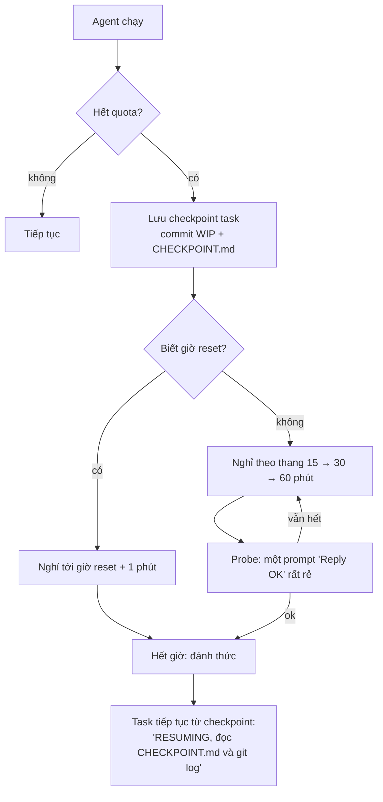
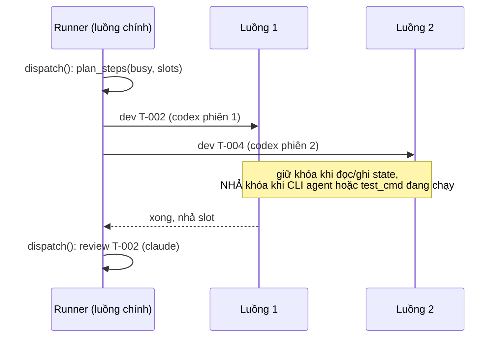

# 2. Quota, chạy song song và rào chắn

## 2.1 Hết quota (usage limit) mà không mất việc

Gói thuê bao có hạn mức theo khung giờ (ví dụ 5 giờ, theo tuần). Orchestrator coi việc hết quota
là chuyện bình thường, không phải lỗi.

**Nhận diện** (`limits.py`, một module duy nhất):

- `STRONG_PATTERNS`: câu chắc chắn là hết quota ("usage limit reached", "hit your limit",
  "5-hour limit reached", "quota exceeded"...), khớp ở mọi lần chạy.
- `WEAK_PATTERNS`: gợi ý yếu ("rate limit", "429", "try again in") chỉ được tin khi CLI thoát với
  mã khác 0, vì code agent viết ra cũng có thể chứa chữ "rate limit".
- Đọc **giờ reset** nếu CLI có nói: epoch, `resets_in_seconds`, "in 2 hours", "at 3pm (Asia/Ho_Chi_Minh)".
  Cộng thêm 1 phút an toàn.

**Nghỉ và quay lại:**



- Hai agent nghỉ **độc lập**: Codex nghỉ thì Claude vẫn viết spec, review task khác.
- Khi không còn gì để làm, `office run` ngủ tới lúc agent sớm nhất thức dậy, và tỉnh sớm nếu có
  lệnh mới trong inbox.
- Hai lần thất bại không rõ lý do liên tiếp cũng được coi như hết quota (nghỉ theo thang).
- Giao diện hiện "Zzz" và giờ thức dậy; PO có thể bấm "Làm lại ngay" (`office wake codex`).

## 2.2 Chạy song song

```toml
[parallel]
claude = 1
codex = 2
```

**Mô hình:** một tiến trình runner, một `ThreadPoolExecutor`, một khóa (`RLock`) bọc toàn bộ thay
đổi trạng thái.



- `dispatch()` hỏi scheduler mọi bước có thể chạy, trừ mục tiêu đang chạy (`busy`) và theo số phiên
  trống của mỗi agent (`slots`), rồi đưa vào thread pool.
- Trong mỗi bước, khóa chỉ được nhả ở ba chỗ chậm: gọi CLI agent, chạy `test_cmd`, chạy `eval_cmd`.
  Mọi thao tác git và ghi state vẫn tuần tự, nên không có race trên `state.json` hay trên nhánh `main`.
- Một agent có nhiều phiên: `agent.active = ["T-002", "T-004"]`. Một phiên chạm quota thì cả agent
  nghỉ; phiên còn lại khi xong sẽ chỉ lưu checkpoint, không báo nghỉ lần hai.
- `office run --sequential` (hoặc `--once`, `--max-steps`) chạy từng bước như cũ.

Thêm phiên giúp nhanh hơn nhưng tiêu quota nhanh hơn. Gợi ý: Codex 2 phiên khi gói ChatGPT Pro,
1 phiên khi gói Plus; Claude 1 phiên là đủ vì việc của Claude ngắn.

## 2.3 Xung đột merge tự gỡ

Hai task song song có thể sửa cùng dòng. Khi task thứ hai tới bước merge:

1. Orchestrator gộp `main` mới nhất vào nhánh task. Sạch thì chạy lại `test_cmd` và `eval_cmd` trên
   bản đã gộp; lỗi thì quay lại Codex.
2. Xung đột thì task quay về `dev` với `git merge main` **đang dở**, prompt nêu danh sách file xung đột.
3. Codex gỡ xung đột, giữ cả hai phần, chạy test.
4. Orchestrator kiểm tra không còn marker `<<<<<<<`/`>>>>>>>` rồi mới commit merge; còn marker thì hủy
   merge và báo PO.
5. Task đi lại test → review → merge. Tối đa `MAX_CONFLICT_ROUNDS = 2`.

Nếu đang gỡ dở mà hết quota, checkpoint sẽ `git merge --abort` trước khi commit WIP, để không bao giờ
commit marker xung đột.

## 2.4 Rào chắn (guardrails)

| Rào chắn | Ở đâu | Khi vi phạm |
|---|---|---|
| `protected_paths` | Sau bước dev | Task `blocked`, báo PO |
| `block_secrets` | Quét các dòng **thêm mới** trong diff: private key, `AKIA...`, `sk-...`, `ghp_...`, `xox...`, `AIza...` | Task `blocked` |
| `max_diff_lines` | Tổng dòng thêm + xóa so với base | Task `blocked` ("chia nhỏ task") |
| `max_calls_per_day` | Trước mỗi lần gọi agent | Agent nghỉ tới nửa đêm (giờ máy) |
| `max_tasks_per_request` | Khi Claude tạo task | Cắt bớt, ghi sự kiện `guardrail` |
| Giới hạn vòng lặp | Test 3 lần, review 3 vòng, xung đột 2 lần, goal check `max_goal_rounds` | `blocked` |
| Sandbox | Claude chỉ có công cụ đọc; Codex `workspace-write` trong worktree | CLI từ chối |
| Không API key | Xóa biến môi trường key trước khi gọi CLI | Luôn dùng gói thuê bao |

## 2.5 Thống kê

`office stats` (hoặc `--json`, `GET /api/stats`):

```text
Agents:
  claude idle     sessions 0/1 | calls today 14/∞, total 14 | limits today 0, rests total 0
  codex  idle     sessions 0/2 | calls today 15/∞, total 15 | limits today 1, rests total 1
Tasks: done 5
Merged 5 | avg review rounds 1.4 | conflicts 1 (resolved 1) | guardrail stops 0 | agent failures 0
Quality (f1): 0.612 → 0.684 → 0.741
```

Dùng số này để chỉnh `[parallel]` và `max_calls_per_day` cho vừa gói thuê bao.

## 2.6 Vì sao chưa dùng SQLite

Chỉ có một tiến trình ghi (runner), các nơi khác gửi lệnh qua inbox, và state chỉ vài trăm KB. File
JSON ghi nguyên tử + một khóa trong tiến trình là đủ, dễ đọc bằng mắt, dễ sao lưu. `events.jsonl`
đã là lịch sử đầy đủ. Khi nào cần nhiều runner trên nhiều máy dùng chung một backlog thì mới đáng
chuyển sang SQLite (WAL) hoặc Postgres.
