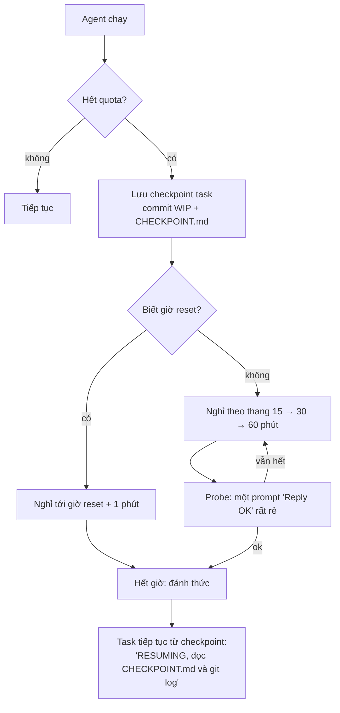
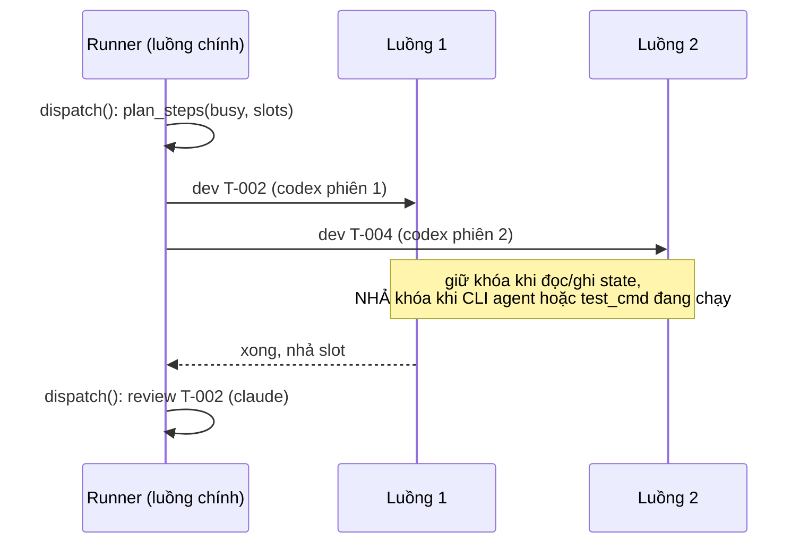

# 2. Quota, chạy song song và rào chắn

## 2.1 Hết quota (usage limit) mà không mất việc

Gói thuê bao có hạn mức theo khung giờ (ví dụ 5 giờ, theo tuần). Orchestrator coi việc hết quota
là chuyện bình thường, không phải lỗi.

**Nhận diện** (`limits.py`, một module duy nhất):

- `STRONG_PATTERNS`: câu chắc chắn là hết quota ("usage limit reached", "hit your limit",
  "5-hour limit reached", "quota exceeded"...), khớp ở mọi lần chạy.
- `WEAK_PATTERNS`: gợi ý yếu ("rate limit", "429", "try again in") chỉ được tin khi CLI thoát với
  mã khác 0, vì code agent viết ra cũng có thể chứa chữ "rate limit".
- Đọc **giờ reset** nếu CLI có nói: epoch, `resets_in_seconds`, "in 2 hours", "at 3pm (Asia/Ho_Chi_Minh)".
  Cộng thêm 1 phút an toàn.

**Nghỉ và quay lại:**



- Quota là của **gói thuê bao (CLI)**, không phải của vai. Bốn vai là bốn agent riêng, nhưng `pm` và
  `lead` cùng dùng Claude, `dev` và `tester` cùng dùng Codex: một vai chạm giới hạn thì **mọi vai trên
  CLI đó nghỉ cùng giờ** (sự kiện `agent_resting` có `provider` và `roles`), một probe đánh thức tất cả.
  Hai CLI nghỉ **độc lập**. Nếu chỉ một CLI hết quota/ngân sách ngày, vai trên CLI kia tiếp quản theo
  cặp `pm` ↔ `dev`, `lead` ↔ `tester`: Codex làm PM/review bằng sandbox chỉ đọc; Claude làm dev/test
  bằng quyền ghi trong worktree. Nếu cả hai cùng nghỉ thì office chờ mốc thức sớm nhất.
- Khi cả hai còn quota, phân vai cũ không đổi. Agent đang bận/hết session hoặc lỗi CLI lặp lại
  không kích hoạt tiếp quản. Mỗi lần đổi vai ghi event `agent_failover` và được đếm trong stats.
- Khi không còn gì để làm, `office run` ngủ tới lúc agent sớm nhất thức dậy, và tỉnh sớm nếu có
  lệnh mới trong inbox.
- Hai lần thất bại không rõ lý do liên tiếp của cùng một CLI (dù từ hai vai khác nhau) thì CLI nghỉ
  với lý do `failure` (thang 15 → 30 → 60 phút), không gọi là hết quota.
- `max_calls_per_day` tính theo CLI: cộng lượt của mọi vai trên CLI đó.
- Giao diện hiện "Zzz" và giờ thức dậy trên bàn của từng vai; PO có thể bấm "Làm lại ngay"
  (`office wake codex` hoặc `office wake tester`: cả hai đánh thức mọi vai trên Codex).

## 2.2 Chạy song song

```toml
[parallel]   # số phiên cùng lúc của từng vai
pm = 1
lead = 1
dev = 2
tester = 1
```

Config cũ `claude = 1` / `codex = 2` vẫn đọc được: số đó áp cho từng vai trên CLI tương ứng.

**Mô hình:** một tiến trình runner, một `ThreadPoolExecutor`, một khóa (`RLock`) bọc toàn bộ thay
đổi trạng thái.



- `dispatch()` hỏi scheduler mọi bước có thể chạy, trừ mục tiêu đang chạy (`busy`) và theo số phiên
  trống của mỗi agent (`slots`), rồi đưa vào thread pool.
- Trong mỗi bước, khóa chỉ được nhả ở ba chỗ chậm: gọi CLI agent, chạy `test_cmd`, chạy `eval_cmd`.
  Mọi thao tác git và ghi state vẫn tuần tự, nên không có race trên `state.json` hay trên nhánh `main`.
- Một agent có nhiều phiên: `agent.active = ["T-002", "T-004"]`. Một phiên chạm quota thì cả agent
  nghỉ; phiên còn lại khi xong sẽ chỉ lưu checkpoint, không báo nghỉ lần hai.
- `office run --sequential` (hoặc `--once`, `--max-steps`) chạy từng bước như cũ.

Thêm phiên giúp nhanh hơn nhưng tiêu quota nhanh hơn. Gợi ý: Codex 2 phiên khi gói ChatGPT Pro,
1 phiên khi gói Plus; Claude 1 phiên là đủ vì việc của Claude ngắn.

## 2.3 Xung đột merge tự gỡ

Hai task song song có thể sửa cùng dòng. Khi task thứ hai tới bước merge:

1. Orchestrator gộp `main` mới nhất vào nhánh task. Sạch thì chạy lại `test_cmd` và `eval_cmd` trên
   bản đã gộp; lỗi thì quay lại Codex.
2. Xung đột thì task quay về `dev` với `git merge main` **đang dở**, prompt nêu danh sách file xung đột.
3. Codex gỡ xung đột, giữ cả hai phần, chạy test.
4. Orchestrator kiểm tra không còn marker `<<<<<<<`/`>>>>>>>` rồi mới commit merge; còn marker thì hủy
   merge và giao Tech Lead.
5. Task đi lại test → review → merge. Tối đa `MAX_CONFLICT_ROUNDS = 2`, sau đó Tech Lead quyết
   (thường là `restart` từ `main` mới, có thể `after` task kia), không hỏi PO (xem 1.10).

Tốt hơn là tránh xung đột từ đầu: spec ghi `files`, scheduler không cho hai task sửa cùng file code
cùng lúc (1.10).

Nếu đang gỡ dở mà hết quota, checkpoint sẽ `git merge --abort` trước khi commit WIP, để không bao giờ
commit marker xung đột.

## 2.4 Rào chắn (guardrails)

| Rào chắn | Ở đâu | Khi vi phạm |
|---|---|---|
| `protected_paths` | Sau bước dev | Không review/merge; Tech Lead bảo Codex hoàn tác phần đó |
| `block_secrets` | Quét các dòng **thêm mới** trong diff: private key, `AKIA...`, `sk-...`, `ghp_...`, `xox...`, `AIza...` | Không review/merge; nhánh bị xóa, Tech Lead cho làm lại từ `main` |
| `max_diff_lines` | Tổng dòng thêm + xóa so với base | Không review; Tech Lead `split` task |
| `max_calls_per_day` | Trước mỗi lần gọi agent | Agent nghỉ tới nửa đêm (giờ máy) |
| `max_tasks_per_request` | Khi Claude tạo task | Cắt bớt, ghi sự kiện `guardrail` |
| Giới hạn vòng lặp | Test 3 lần, review 3 vòng, xung đột 2 lần, goal check `max_goal_rounds` | Tech Lead quyết (`tech_lead_rounds`); goal check hết vòng thì đóng yêu cầu + báo cáo |
| Sandbox | Claude chỉ có công cụ đọc + vài lệnh trong `allowed_commands`; Codex `workspace-write` trong worktree (có mạng, xem 2.7) | CLI từ chối |
| Không API key | Xóa biến môi trường key trước khi gọi CLI | Luôn dùng gói thuê bao |

## 2.5 Thống kê

`office stats` (hoặc `--json`, `GET /api/stats`):

```text
Subscriptions (quota shared by their roles):
  claude idle     roles pm, lead | calls today 14/∞, total 14 | limits today 0, rests total 0
  codex  idle     roles dev, tester | calls today 15/∞, total 15 | limits today 1, rests total 1
Agents (one per role):
  pm     @claude idle     sessions 0/1 | calls today 7, total 7
  lead   @claude idle     sessions 0/1 | calls today 7, total 7
  dev    @codex  idle     sessions 0/2 | calls today 8, total 8
  tester @codex  idle     sessions 0/1 | calls today 7, total 7
Tasks: done 5
Merged 5 | avg review rounds 1.4 | conflicts 1 (resolved 1) | guardrail stops 0 | agent failures 0
Quality (f1): 0.612 → 0.684 → 0.741
```

Dùng số này để chỉnh `[parallel]` và `max_calls_per_day` cho vừa gói thuê bao.

## 2.6 Vì sao chưa dùng SQLite

Chỉ có một tiến trình ghi (runner), các nơi khác gửi lệnh qua inbox, và state chỉ vài trăm KB. File
JSON ghi nguyên tử + một khóa trong tiến trình là đủ, dễ đọc bằng mắt, dễ sao lưu. `events.jsonl`
đã là lịch sử đầy đủ. Khi nào cần nhiều runner trên nhiều máy dùng chung một backlog thì mới đáng
chuyển sang SQLite (WAL) hoặc Postgres.

## 2.7 Agent tự cài dependency khi thiếu

**Vì sao trước đây agent không tự cài được.** Hai CLI chạy không tương tác và mặc định chặn đúng
những việc cần để cài thư viện:

- `codex exec --sandbox workspace-write` chỉ cho ghi trong worktree và **tắt mạng**, nên
  `pip install` / `npm install` không tải được gì. Kể cả có mạng, `pip` cài vào Python hệ thống
  (ngoài worktree) cũng bị sandbox chặn.
- `claude -p` chỉ được dùng các công cụ trong `--allowedTools` (đọc file, `git diff/log/show`).
  Ở chế độ `-p` không có ai bấm "Allow", nên mọi lệnh khác bị từ chối.
- Prompt cũ bảo "gặp gì chặn thì trả lời `BLOCKED:`", nên thiếu module cũng thành câu hỏi cho PO.

**Bây giờ có 4 lớp tự sửa:**

| Lớp | Cấu hình | Làm gì |
|---|---|---|
| Mạng cho Codex | `[codex] network = true` (mặc định) | Thêm `-c sandbox_workspace_write.network_access=true`. Codex vẫn chỉ ghi được trong worktree |
| Môi trường riêng mỗi worktree | `[office] setup_cmd` | Orchestrator (ngoài sandbox, có mạng) chạy lệnh này khi tạo worktree. Nếu nó tạo `.venv/`, thì `.venv/bin` được đặt đầu `PATH` của Codex, Claude, `test_cmd` và `eval_cmd`, nên `pip install` từ trong sandbox cài vào `.venv/` (nằm trong worktree, ghi được). `.venv/` không bao giờ bị commit |
| Prompt dạy tự gỡ | `prompts/dev.md`, `prompts/test.md` | Thiếu package/tool **không phải** blocker: tự cài vào `.venv/` (hoặc `npm install` trong worktree), khai báo vào `pyproject.toml` / `requirements*.txt` / `package.json`, chạy lại. Không `sudo`, không cài ra ngoài worktree. Chỉ sau 2 lần cài vẫn lỗi mới `BLOCKED:` kèm lệnh và dòng lỗi |
| Orchestrator thử lại | `[office] dep_retries = 2` | Nếu Codex vẫn trả `BLOCKED:` mà lý do giống thiếu dependency (`ModuleNotFoundError`, `command not found`, `No matching distribution`, lỗi DNS...), office chạy lại `setup_cmd`, ghi kết quả vào prompt dev lần sau (mục `ENVIRONMENT`) rồi giao lại. Hết số lần thì Tech Lead quyết (không hỏi PO). Blocker khác cũng qua Tech Lead; chỉ câu hỏi nghiệp vụ mới tới PO |

Claude vẫn là PM/Reviewer, **không** cài gì. `[claude] allowed_commands` (mặc định `python -m pytest`,
`pytest`, `ffprobe`, `ffmpeg -version`) chỉ để reviewer tự chạy test khi cần. Mỗi mục thành
`--allowedTools "Bash(<lệnh>:*)"`, tức là cho phép theo tiền tố lệnh, không dùng
`--dangerously-skip-permissions`.

Ví dụ cho SportsCut (Python):

```toml
[office]
setup_cmd = "python3 -m venv .venv && .venv/bin/python -m pip install -q -e '.[dev]' || .venv/bin/python -m pip install -q pytest"
dep_retries = 2
test_cmd = ".venv/bin/python -m pytest -q"
```

`ffmpeg`/`ffprobe` là công cụ hệ thống: cài một lần trên máy chạy office (`brew install ffmpeg`,
`apt install ffmpeg`), agent không tự cài bằng `sudo`.

Các rào chắn khác giữ nguyên: secret vẫn bị chặn trước review, `max_calls_per_day` vẫn tính mỗi
lần giao lại, và `protected_paths` vẫn được kiểm tra.


## 2.8 Chạy Codex qua codex-lb (gộp nhiều tài khoản ChatGPT)

[codex-lb](https://github.com/Soju06/codex-lb) là proxy mã nguồn mở đứng giữa Codex CLI và
ChatGPT: thêm nhiều tài khoản ChatGPT, nó chia tải và tự chuyển tài khoản khi một tài khoản hết
quota, kèm dashboard theo dõi lượt dùng. Với office, đó là cách tăng quota cho Developer và Tester
mà vẫn dùng gói thuê bao. Key của codex-lb là key của proxy trên máy anh, không phải API key trả
tiền, nên office cho phép dùng (quyết định trong `docs/superpowers/DECISIONS.md`).

**1. Chạy codex-lb** (một lần trên máy chạy office):

```bash
uvx codex-lb            # hoặc Docker:
docker run -d --name codex-lb -p 2455:2455 -p 1455:1455 \
  -v codex-lb-data:/var/lib/codex-lb ghcr.io/soju06/codex-lb:latest
```

Mở `http://localhost:2455`, bấm **Add account** để thêm các tài khoản ChatGPT. Nếu bật xác thực
bằng API key (bắt buộc khi Codex ở máy khác), tạo key trong dashboard.

**2. Trỏ Codex vào codex-lb** trong `~/.codex/config.toml` (hoặc `$CODEX_HOME/config.toml`):

```toml
model_provider = "codex-lb"

[model_providers.codex-lb]
name = "openai"                 # bắt buộc (bản Codex cũ dùng "OpenAI")
base_url = "http://127.0.0.1:2455/backend-api/codex"
wire_api = "responses"
requires_openai_auth = true
env_key = "CODEX_LB_API_KEY"    # chỉ cần khi codex-lb bật API key
```

**3. Đưa key cho office.** Codex đọc key từ biến môi trường tên trong `env_key`. Nếu tiến trình
chạy `office run` / `office dashboard` không có biến đó (ví dụ chỉ `export` trong `.zshrc` của một
terminal khác, hoặc office được mở từ app/launchd), `codex exec` dừng với
`Missing environment variable: CODEX_LB_API_KEY`. Cách chắc chắn nhất: ghi key vào
`.agent-office/.env` của repo đích (thư mục `.agent-office/` bị git bỏ qua, không bao giờ commit):

```bash
echo 'CODEX_LB_API_KEY=sk-clb-...' >> .agent-office/.env
chmod 600 .agent-office/.env
office doctor
```

Office đọc file này **trước mỗi lần gọi** CLI (đổi đường dẫn bằng `[office] env_file`), nên sửa
xong không cần khởi động lại. Biến `env_key` của provider Codex luôn được giữ lại, kể cả khi trùng
tên một API key mà office thường xóa (ví dụ `OPENAI_API_KEY`); các API key khác vẫn bị xóa.

**4. Kiểm tra** bằng `office doctor`:

```text
ok      codex provider: codex-lb (/Users/<anh>/.codex/config.toml), base_url http://127.0.0.1:2455/backend-api/codex
FAIL    codex key CODEX_LB_API_KEY: not set, so `codex exec` stops with 'Missing environment variable: CODEX_LB_API_KEY'
        -> add `CODEX_LB_API_KEY=<key>` to .agent-office/.env (...; git ignores it) or export it in the shell that runs `office run` / `office dashboard`
ok      codex server http://127.0.0.1:2455/backend-api/codex: reachable
```

Doctor không bao giờ in giá trị key. Dòng `codex server` FAIL nghĩa là codex-lb chưa chạy.
`office doctor --live` gửi một prompt nhỏ qua codex-lb để chắc chắn mọi thứ thông.

**Key phải nằm ở đâu.** Office đọc `.agent-office/.env` của **repo đích** (thư mục chạy
`office run`), không phải của `agent-office/` hay của worktree. Đặt key trong `~/.codex/.env`
không có tác dụng: Codex không cho file đó đặt biến bắt đầu bằng `CODEX_`. Chạy `codex exec` bằng
tay trong terminal cũng không đọc `.agent-office/.env`, nên lỗi khi chạy tay không có nghĩa là
office lỗi.

**Kiểm tra một lần gọi cụ thể.** Mỗi log `.agent-office/logs/<task>/NNN-<bước>-<vai>.log` có dòng
`--- env: env_file ... (exists) gives CODEX_LB_API_KEY; provider codex-lb needs CODEX_LB_API_KEY: set ---`
(chỉ tên biến, không có giá trị). `MISSING` ở đây nghĩa là file sai chỗ hoặc sai tên biến.
Log được ghi **trong lúc** agent chạy (`tail -f <log>`) và đường dẫn log in ngay khi bắt đầu
(`[tester@codex] test (T-008)... log ...`), nên một Codex đang làm bài test lâu sẽ không còn
trông như bị treo. Nếu Codex in `Missing environment variable` mà không tự thoát, office dừng
nó ngay.

**Khi thiếu key lúc đang chạy:** office không gọi Codex (không tốn lượt), không tính là hết quota
hay CLI lỗi. Dev và Tester nghỉ với lý do `environment problem for the user`, PO nhận **một** tin
"Cần anh sửa trên máy" kèm cách sửa, Claude tạm làm thay việc của Codex (như khi Codex hết
quota). Cứ 5 phút office tự kiểm tra lại trên máy (không gọi CLI); thấy key là Codex làm tiếp.
Muốn chạy ngay: `office wake codex`.
