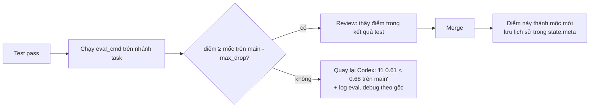
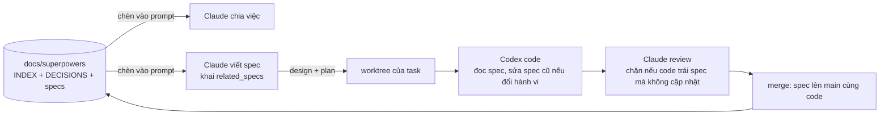

# 3. Kỷ luật kỹ thuật cho agent và cổng chất lượng

Mô hình mạnh vẫn có thói quen xấu: viết code trước rồi viết test cho khớp, báo "đã xong" khi chưa
chạy, sửa lỗi bằng cách thử bừa. Dự án chống lại các thói quen này ở ba lớp: **prompt**, **file quy
tắc trong repo**, và **kiểm tra của orchestrator** (lớp cuối không phụ thuộc mô hình có nghe lời hay không).

## 3.1 Superpowers

[Superpowers](https://github.com/obra/superpowers) là bộ "skill" cho coding agent: mỗi skill là một
quy trình ngắn mô tả cách làm một việc cho đúng. Dự án dùng các skill sau:

| Skill | Vai áp dụng | Nội dung đưa vào prompt |
|---|---|---|
| `brainstorming` | Claude chia việc | Nêu mục tiêu đo được; so 2–3 hướng; chọn hướng đơn giản nhất (YAGNI); việc về chất lượng thì task đầu là xây phép đo |
| `writing-plans` | Claude viết spec | Spec là kế hoạch cho người không có ngữ cảnh: file cụ thể, chữ ký hàm, bước nhỏ theo thứ tự test trước, lệnh chứng minh xong |
| `test-driven-development` | Codex code | Viết test, **thấy nó đỏ đúng lý do**, code tối thiểu, thấy xanh, refactor |
| `systematic-debugging` | Codex khi test/eval lỗi | Tái hiện, đọc hết lỗi, một giả thuyết mỗi lần, sửa nhỏ nhất; ba lần không được thì xem lại thiết kế |
| `verification-before-completion` | Codex code + test | Không khẳng định gì nếu chưa chạy lệnh trong phiên này; trích dòng kết quả |
| `requesting-code-review` / `receiving-code-review` | Claude review | Đối chiếu spec; test phải chứng minh AC; đọc bằng chứng TDD; chỉ chặn vì lỗi thật |
| `using-git-worktrees` | Orchestrator | Đã làm sẵn: mỗi task một worktree |

Các quy tắc này nằm **ngay trong prompt**, nên có hiệu lực kể cả khi chưa cài plugin. Nếu đã cài
(`office doctor` sẽ báo), prompt nhắc agent gọi đúng skill để có hướng dẫn đầy đủ hơn:

```text
claude
/plugin marketplace add obra/superpowers-marketplace
/plugin install superpowers@superpowers-marketplace
```

## 3.2 AGENTS.md và CLAUDE.md

- Codex tự đọc `AGENTS.md` ở gốc repo; Claude Code tự đọc `CLAUDE.md` (file này chỉ có dòng
  `@AGENTS.md` để import, cộng vài dòng riêng cho Claude). Một nguồn quy tắc cho cả hai.
- Nội dung: vai trò, 7 quy tắc làm việc (đo trước, plan nhỏ, TDD, debug theo gốc, bằng chứng, review
  lỗi thật, YAGNI/DRY), an toàn (không commit secret/video), và "Project specifics" (lệnh test, lệnh
  eval, ngân sách hiệu năng).
- `office init` tạo hai file này nếu repo chưa có. Nên thêm chúng vào `protected_paths` để agent
  không tự sửa luật của mình.

## 3.3 Bằng chứng thay vì lời hứa

| Bằng chứng | Ai tạo | Ai dùng |
|---|---|---|
| `.office/DEV_NOTES.md`: mỗi hành vi → tên test → dòng lỗi lúc đỏ → lệnh và kết quả lúc xanh | Codex dev | Claude review (được chèn vào prompt review) |
| `.office/TEST_REPORT.md`: mỗi AC → test → pass/fail + lệnh đã chạy | Codex test | Claude review |
| Kiểm tra "test có thể fail": cố ý làm hỏng code ở AC quan trọng nhất, xác nhận test đỏ, khôi phục | Codex test | Chống test rỗng |
| `test_cmd` do orchestrator tự chạy | Orchestrator | Cổng bắt buộc trước review |
| `eval_cmd` do orchestrator tự chạy | Orchestrator | Cổng chất lượng (bên dưới) |

## 3.4 Cổng chất lượng: phát triển theo số đo (eval-driven development)

Với sản phẩm AI như cắt highlight, "test pass" chưa đủ: code đúng vẫn có thể chọn sai khoảnh khắc.
Vì vậy chất lượng được biến thành một con số và orchestrator canh con số đó.

```toml
[quality]
eval_cmd = "sportscut eval tests/fixtures/eval --json"   # in JSON có chỉ số
metric = "f1"
higher_is_better = true
max_drop = 0.0
```



- Mốc (baseline) là điểm của task merge gần nhất; task đầu tiên đặt mốc.
- Khi `main` đổi trong lúc task chờ merge, eval chạy lại trên bản đã gộp.
- Reviewer coi điểm tụt là `blocker`.
- PM được dặn: yêu cầu về chất lượng thì task đầu tiên phải xây bộ đo (dữ liệu có nhãn + lệnh eval).

Đây là cùng ý tưởng với "eval-driven development" trong phát triển ứng dụng LLM: không tối ưu thứ
không đo được, và không merge thứ làm số đo xấu đi.

## 3.5 Spec, plan và quyết định được lưu trong repo

Trước đây spec, tiêu chí nghiệm thu (AC) và các quyết định chỉ nằm trong `.agent-office/state.json`
và `.office/TASK.md` của worktree. Cả hai đều bị git bỏ qua, worktree bị xóa sau khi merge, nên yêu
cầu sau không biết yêu cầu trước đã quyết định gì. Giờ orchestrator ghi chúng vào repo theo đường
dẫn của Superpowers và **commit cùng code của task** (cùng PR, được review cùng, merge cùng):

| File | Nội dung | Ai tạo |
|---|---|---|
| `docs/superpowers/specs/YYYY-MM-DD-r-xxx-<chủ đề>-design.md` | Thiết kế của cả yêu cầu: mục tiêu, các hướng đã cân nhắc, hướng chọn và lý do | Claude chia việc (trường `design`) |
| `docs/superpowers/specs/YYYY-MM-DD-t-xxx-<chủ đề>-design.md` | Task làm gì, AC, ngoài phạm vi, quyết định, spec cũ bị thay đổi | Claude viết spec |
| `docs/superpowers/plans/YYYY-MM-DD-t-xxx-<chủ đề>.md` | Các bước triển khai và kế hoạch test; Codex thêm mục `## Deviations` nếu làm khác plan | Claude viết spec, Codex bổ sung |
| `docs/superpowers/INDEX.md` | Mục lục tính năng: mỗi task một dòng, link tới design và plan | Orchestrator |
| `docs/superpowers/DECISIONS.md` | Nhật ký quyết định: ngày, task, yêu cầu, quyết định | Orchestrator (từ trường `decisions`) |

Cách các vai dùng chúng:



- Mọi prompt PM (chia việc, viết spec, kiểm tra mục tiêu) và review đều nhận nội dung `INDEX.md` +
  `DECISIONS.md`. Prompt dev chỉ tới các file đó qua mục "Persistent spec" trong `.office/TASK.md`.
- Nếu task thay đổi hành vi đã mô tả trong spec cũ, PM ghi spec đó vào `related_specs`, Codex cập
  nhật nó (`Updated by T-xxx: ...`), reviewer coi spec bị bỏ quên hoặc mâu thuẫn là `blocker`.
- `INDEX.md` và `DECISIONS.md` chỉ được thêm dòng và dùng `merge=union` trong `.gitattributes`,
  nên nhiều task song song không bao giờ xung đột ở hai file này.
- File spec chỉ được ghi lần đầu: chỉnh sửa sau đó của Codex hay task khác được giữ nguyên.
- `docs/superpowers/` không tính vào giới hạn `max_diff_lines`.
- Tất cả do orchestrator làm, nên có hiệu lực kể cả khi chưa cài plugin Superpowers.
