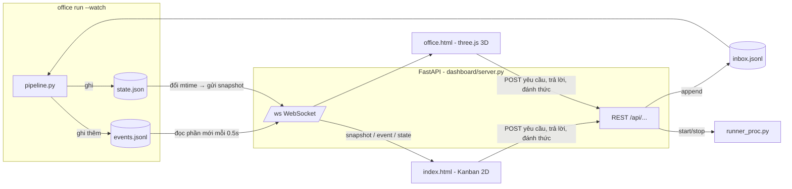

# 4. Văn phòng 3D và dashboard

Mục đích: **nhìn thấy** các agent làm việc với nhau. Ai đang làm gì, ai giao việc cho ai, ai hết
quota, task nào vừa merge. Giao diện chỉ đọc trạng thái, không điều khiển agent trực tiếp. Mọi lệnh
của PO đều đi qua inbox.

## 4.1 Kiến trúc



- **Event sourcing nhẹ:** pipeline ghi mọi việc xảy ra thành một dòng JSON trong `events.jsonl`
  (`stage_changed`, `agent_working`, `agent_resting`, `message`, `pr_merged`, `merge_conflict`...).
  Giao diện dựng hiệu ứng từ sự kiện, dựng màn hình từ snapshot.
- **WebSocket `/ws`:** khi kết nối, server gửi `snapshot` (state + 300 sự kiện gần nhất); sau đó cứ
  0,5 giây đọc phần mới của `events.jsonl` (theo byte offset, chỉ lấy dòng hoàn chỉnh) và gửi từng
  `event`; khi `state.json` đổi `mtime`, runner bật/tắt hay inbox đổi thì gửi `state` mới.
  Không cần message broker. Server và runner chỉ dùng chung file.
- **REST:** `GET /api/state`, `/api/stats`, `/api/events`, log và ghi chú từng task;
  `POST /api/requests`, `/api/tasks/{id}/answer`, `/api/requests/{id}/retry`,
  `/api/agents/{name}/wake`, `/api/runner/start|stop`.
- **Bảo mật:** server chỉ nghe `127.0.0.1`; tên file log được kiểm tra bằng regex để chặn
  path traversal.

## 4.2 Sự kiện hội thoại

Mỗi bước giao việc phát một sự kiện `message`:

```json
{"event": "message", "frm": "claude", "to": "codex", "task_id": "T-002", "topic": "assign",
 "text": "Giao T-002 'Tách audio bằng ffmpeg'. Spec ở .office/TASK.md. Cần đạt: ..."}
```

`topic` gồm: `request`, `plan`, `question`, `assign`, `dev_done`, `handoff`, `test_fail`, `approve`,
`changes`, `conflict`, `merged`, `done`, `rest`, `awake`, `answer`. Giao diện dùng `topic` để tô màu
(vàng = cần chú ý, xanh = thành công) và chọn hiệu ứng.

## 4.3 Cảnh 3D (three.js r160)

| Thành phần | Kỹ thuật |
|---|---|
| Nạp thư viện | `three.module.min.js` + `OrbitControls.js` vendored trong `static/vendor/`, nạp bằng **import map**, không cần build, không cần mạng |
| Camera | `PerspectiveCamera` 42°, `OrbitControls` để xoay/zoom, có giới hạn góc |
| Ánh sáng | `HemisphereLight` + `DirectionalLight` có bóng (`shadowMap`, 1024²); bảng màu riêng cho dark mode |
| Nhân vật | Ghép khối đơn giản (capsule thân, cầu đầu, tay), màu theo agent: Claude cam, Codex xanh lục, PO xanh dương |
| Màn hình máy tính | `CanvasTexture`: vẽ chữ "review1 T-002" hoặc "2 việc T-002, T-004" lên canvas 2D rồi dán lên mặt màn hình; chỉ vẽ lại khi nội dung đổi |
| Kanban trên tường | Một `CanvasTexture` lớn, vẽ cột theo stage, thẻ task có viền khi đang chạy |
| Đèn bàn | Vật liệu `emissive`: xanh = đang làm, vàng = nghỉ, xanh dương = PO cần trả lời, xám = rảnh |
| Server `main` | Tủ máy có LED; nháy nhanh khi có merge |
| Hoạt ảnh | Nhân vật nhấp nhô và gõ phím khi làm, gục đầu khi nghỉ, nghiêng đầu khi hỏi; tôn trọng `prefers-reduced-motion` |

**Lớp chữ HTML trên cảnh 3D (overlay):** nhãn tên, bong bóng thoại, "Zzz" là thẻ HTML thường đặt
tuyệt đối. Mỗi khung hình, điểm 3D trên đầu nhân vật được chiếu ra màn hình
(`vector.project(camera)` → tọa độ pixel) để đặt thẻ, và ẩn đi khi nằm sau camera. Chữ HTML luôn
sắc nét, chọn được, đọc được bằng trình đọc màn hình, dễ hơn vẽ chữ trong WebGL.

**Tờ giấy bay (handoff):** khi có `message` giữa hai bàn, một tấm giấy nhỏ (mặt phẳng) bay theo
đường vòng cung từ bàn người gửi sang bàn người nhận. Vị trí theo thời gian dùng nội suy tuyến tính
với easing in-out cộng độ cao `sin(π·t)`, kèm nhãn mã task. Tin `merged` bay vào server `main`.

**Bong bóng thoại:** hiện khoảng 7 giây trên đầu người gửi rồi mờ dần; khung chat bên phải lưu toàn
bộ hội thoại.

## 4.4 Nhiều phiên cùng lúc

`agent.active` trong state là danh sách task một agent đang làm. Giao diện giữ
`sessions[agent] = {task: nhãn}` cập nhật từ `agent_working` / `agent_done` / `agent_failed` /
`agent_resting` và đồng bộ lại từ mỗi snapshot. Nhãn bàn và màn hình hiện
"Codex · 2 việc T-002, T-004"; thẻ agent trên Kanban 2D hiện "Hôm nay 5 lượt · 2/2 phiên".

## 4.5 Chế độ demo (không tốn quota)

`office demo` tạo một repo git mẫu, bật `simulate = true` và mở văn phòng 3D. `SimAgent`
(`agents/sim.py`) thay cho CLI thật: nhận diện loại prompt, ngủ `sim_delay` giây, trả lời đúng định
dạng như agent thật, ghi file thật vào worktree. Kịch bản có sẵn: chia 5 task SportsCut có phụ
thuộc, một vòng review yêu cầu sửa, Codex hết quota một lần, hai task song song sửa cùng file
`sportscut/commands.py` để sinh xung đột thật và tự gỡ. Demo đi qua đúng code pipeline thật, nên cũng
là cách kiểm thử end-to-end.

## 4.6 Dashboard 2D

`index.html` + `app.js`: thẻ agent (trạng thái, đếm ngược giờ nghỉ, lượt gọi hôm nay, phiên),
khung "Cần anh trả lời", ô gửi yêu cầu, Kanban theo stage, ngăn chi tiết task (tổng quan, review &
test, lịch sử, log), dòng hoạt động realtime. HTML/CSS/JS thuần, không build, chạy được offline.
