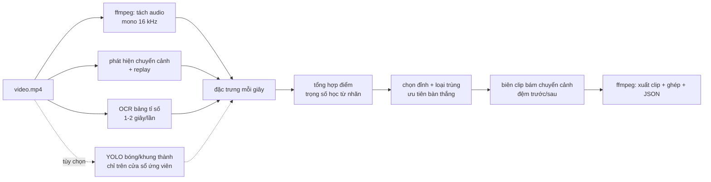

# 5. Công nghệ cắt highlight SportsCut

> Trạng thái: phần sản phẩm do văn phòng agent xây qua hai yêu cầu PO:
> [MVP](../agent-office/examples/sportscut/po_request.md) (tín hiệu rẻ: âm thanh + chuyển cảnh) và
> [độ chính xác cao](../agent-office/examples/sportscut/po_request_accuracy.md) (đo bằng F1, đa tín hiệu).
> Tài liệu này mô tả kỹ thuật mà các yêu cầu đó hướng tới. Code cụ thể nằm trong `sportscut/` khi các
> task được merge.

## 5.1 Bài toán

Đầu vào: một video trận đấu (60–120 phút). Đầu ra: N clip 10–30 giây chứa những pha đáng xem nhất,
một video ghép `highlights.mp4` và `highlights.json` (start, end, score, lý do). Ràng buộc: CPU laptop,
trận 90 phút xử lý dưới 10 phút.

Cách tiếp cận: **tính điểm "đáng xem" cho từng giây** từ nhiều tín hiệu rẻ, chọn các đỉnh, rồi cắt
clip bám theo ranh giới cảnh quay.

## 5.2 Các tín hiệu

### Âm thanh (rẻ nhất, mạnh nhất cho bóng đá)
- **RMS năng lượng theo giây** + chuẩn hóa z-score: tiếng hò reo, bình luận viên hét lên.
- **Nền thích nghi:** trừ median trượt (vài phút) để sân ồn cả trận vẫn thấy đỉnh tương đối.
- **Spectral flux / năng lượng dải cao:** tiếng đám đông bùng nổ có phổ rộng, khác nhạc nền.
- **Tiếng còi:** âm gần như đơn tần 2–4 kHz kéo dài 0,3–1 giây (lỗi, thẻ, bắt đầu/kết thúc).
- **Cao độ giọng bình luận:** cao độ và tốc độ nói tăng khi có pha nguy hiểm.
- Công cụ: `ffmpeg` tách WAV, `numpy` tính khung; không cần model ML.

### Hình ảnh: chuyển cảnh và replay
- **Chuyển cảnh (shot boundary):** so sánh histogram/màu giữa các khung (PySceneDetect
  `ContentDetector` hoặc ffmpeg `select='gt(scene,0.3)'`). Dùng để cắt clip đúng ranh giới.
- **Replay:** đài truyền hình thường chiếu lại ngay sau pha hay, mở đầu bằng hiệu ứng logo
  chuyển cảnh hoặc quay chậm. Phát hiện đoạn replay là tín hiệu "pha vừa rồi đáng xem" rất mạnh.
- **Tỉ lệ cận cảnh:** sau bàn thắng có nhiều cận cảnh ăn mừng và khán giả.

### Bảng tỉ số (OCR): chính xác nhất cho bàn thắng
- Tìm vùng bảng tỉ số: vùng có chữ đứng yên gần như cả trận (phương sai theo thời gian thấp).
- OCR 1–2 giây một lần (Tesseract hoặc EasyOCR, extra tùy chọn), chỉ trên vùng nhỏ đó.
- Tỉ số đổi → có bàn thắng; lùi lại 20–60 giây để lấy pha ghi bàn (thường trước replay).

### Thị giác máy tính (tùy chọn)
- YOLO phát hiện bóng, cầu thủ, khung thành trên các cửa sổ ứng viên, không chạy mọi khung hình.
- Chỉ thêm khi các tín hiệu rẻ chưa đạt mục tiêu F1, vì tốn CPU và phải tải model.

## 5.3 Tổng hợp và chọn clip

- Mỗi giây một vector đặc trưng (audio z-score, flux, còi, chuyển cảnh gần, replay sắp tới,
  tỉ số đổi...).
- **Học trọng số** từ phần dev của bộ nhãn (logistic regression đủ dùng, ít dữ liệu vẫn ổn),
  thay cho trọng số tay.
- **Chọn đỉnh:** làm mượt, lấy đỉnh cục bộ, **non-maximum suppression** theo khoảng cách tối thiểu
  giữa hai clip; bàn thắng (từ OCR) luôn được giữ.
- **Biên clip:** đệm khoảng 8 giây trước và 4 giây sau đỉnh, rồi bám vào chuyển cảnh gần nhất để
  không cắt giữa cảnh hoặc giữa câu bình luận.
- **Ablation:** eval in F1 khi bỏ từng tín hiệu, để biết tín hiệu nào thật sự có ích.

## 5.4 Đo độ chính xác (eval)

| Thành phần | Cách làm |
|---|---|
| Dữ liệu | Mỗi trận: `video.mp4` + `labels.json` (`start`, `end`, `type`, `importance`) hoặc `labels.csv` dạng `mm:ss,mm:ss,type` |
| Bộ tổng hợp | `tests/fixtures/eval/`: video sinh bằng ffmpeg (tiếng ồn bùng lên, còi, chuyển cảnh, quay chậm, chữ tỉ số đổi) với nhãn biết trước; chạy trong CI |
| Bộ thật | `data/eval/` (không vào git), 3–5 trận PO có quyền dùng |
| So khớp | Clip khớp nhãn khi IoU thời gian ≥ 0,3 hoặc chứa trọn khoảnh khắc chính; mỗi nhãn khớp tối đa một clip |
| Chỉ số | precision, recall, **F1**, `goal_recall`, precision@10, giây xử lý/phút video |
| Lệnh | `sportscut eval DIR --json` → một dòng JSON; dùng làm `eval_cmd` của văn phòng |
| Mục tiêu | Bộ thật: F1 ≥ 0,75, goal_recall ≥ 0,95, precision@10 ≥ 0,8. Bộ tổng hợp: F1 ≥ 0,9 |

IoU thời gian = độ dài giao / độ dài hợp của hai đoạn `[start, end]`.

## 5.5 Hiệu năng

- Đọc audio một lần, xử lý bằng numpy theo khối.
- Phát hiện cảnh trên video giảm độ phân giải (ví dụ 320 px, 2–5 khung/giây).
- OCR chỉ trên vùng bảng tỉ số, thưa theo thời gian; vision chỉ trên ứng viên.
- Xuất clip bằng `ffmpeg -ss ... -t ... -c copy` khi có thể (không mã hóa lại), chỉ mã hóa lại khi
  cần cắt chính xác khung hình hoặc ghép.
