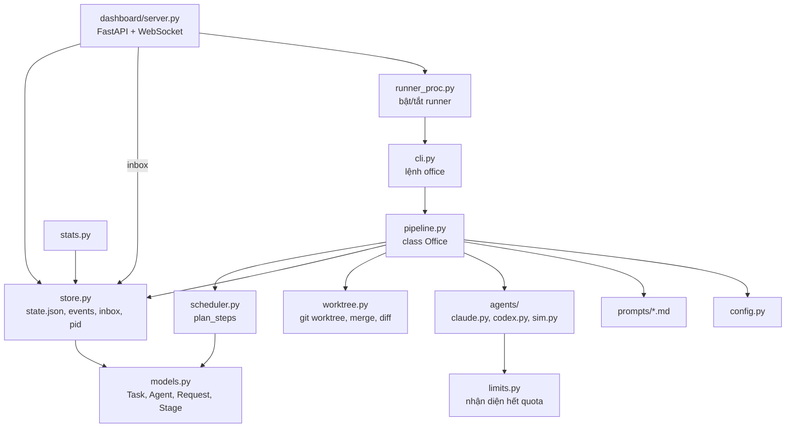

# 6. Code đã implement thế nào để các agent làm việc với nhau

Toàn bộ orchestrator nằm trong `agent-office/agent_office/`, Python 3.11+ thuần (thư viện chuẩn),
FastAPI chỉ cần cho giao diện. Khoảng 2.500 dòng, đọc hết trong một buổi.

## 6.1 Bản đồ module



| Module | Trách nhiệm | Hàm/lớp chính |
|---|---|---|
| `models.py` | Dữ liệu và luật chuyển trạng thái | `Stage`, `TRANSITIONS`, `STAGE_AGENT`, `Task.move/block`, `Agent.count_call`, `Request` |
| `store.py` | Lưu trữ trên đĩa, không có logic nghiệp vụ | `Store.load/save` (ghi nguyên tử), `event()`, `append_inbox/take_inbox`, `claim_runner/release_runner` |
| `config.py` | Đọc `config.toml`, giá trị mặc định | `DEFAULT_CONFIG`, `load_config()`, `Config` |
| `scheduler.py` | Quyết định bước tiếp theo (hàm thuần) | `plan_steps(store, now, auto_merge, busy, slots)`, `next_step()` |
| `pipeline.py` | Thực thi bước: gọi agent, chuyển stage, commit, merge | `Office.step()`, `dispatch()`, `_execute()`, `_call()`, `_breakdown/_spec/_dev/_test/_review/_pr/_goal_check` |
| `agents/base.py` | Chạy CLI headless an toàn | `CliAgent.run()`, `subscription_env()`, `AgentResult`, `extract_json()` |
| `agents/claude.py`, `codex.py` | Dựng lệnh và đọc đầu ra từng CLI | `build_cmd()`, `parse()` |
| `agents/sim.py` | Agent giả để demo và test | `SimAgent` |
| `limits.py` | Nhận diện hết quota, tính giờ nghỉ | `detect()`, `rest_until()` |
| `worktree.py` | Mọi lệnh git | `ensure_worktree`, `commit_all`, `update_from_base`, `start_merge`, `conflict_markers`, `merge_local`, `merge_pr`, `added_lines` |
| `stats.py` | Thống kê | `collect()`, `render()` |
| `prompts/*.md` | Hướng dẫn cho từng vai (template `$biến`) | `prompt(name, **vars)` |
| `templates/` | `AGENTS.md`, `CLAUDE.md` mẫu cho repo mới | dùng trong `office init` |

## 6.2 Một bước chạy như thế nào

```python
# pipeline.py (rút gọn)
def step(self):
    with self.lock:
        self.drain_inbox()            # lệnh của PO: yêu cầu mới, trả lời, đánh thức
        self.sync_merged()            # PR do người merge tay -> done
        plan = next_step(self.store, self.clock(), auto_merge)
        if plan.step: self._execute(plan.step)   # wake | breakdown | goal | task
        return plan.step

def _execute(self, s):
    handler = {TODO: _todo, SPEC: _spec, DEV: _dev, TEST: _test, REVIEW: _review, PR: _pr}[task.stage]
    handler(task); self.store.save()
```

Mỗi handler theo cùng một khuôn:

1. Chuẩn bị ngữ cảnh (worktree, ghi `.office/TASK.md`).
2. `res = self._call(agent, prompt(...), cwd, task_id, label, task)`, trả `None` nếu agent hết quota
   hoặc lỗi (khi đó đã có checkpoint, task giữ nguyên stage và sẽ chạy lại sau).
3. Đọc kết quả (JSON hoặc `RESULT:` hoặc `BLOCKED:`), kiểm tra (test_cmd, eval, rào chắn).
4. `self._move(task, stage_mới)` + `self.say(người_gửi, người_nhận, "...")` để giao việc.

`_call()` là nơi duy nhất gọi agent: kiểm tra agent đang nghỉ, ngân sách ngày, tăng bộ đếm, đánh dấu
`agent.active`, **nhả khóa** trong lúc CLI chạy, rồi xử lý hết quota (`_rest` + `_checkpoint`) hoặc
lỗi (đếm `failures`).

## 6.3 Luồng dữ liệu giữa các agent

Agent không gửi tin cho nhau. Dữ liệu đi theo đường sau:

| Từ → tới | Qua đâu |
|---|---|
| PO → Claude | `Request.text` + `po_answers` → biến `$request` trong prompt |
| Claude (chia việc) → orchestrator | JSON `tasks` → `Task(title, brief, depends_on)` |
| Claude (spec) → Codex | `task.spec`, `acceptance_criteria`, `test_plan` → `.office/TASK.md` trong worktree |
| Codex (dev) → Codex (test) | Code trong worktree (đã commit) + `.office/DEV_NOTES.md` |
| Codex (test) → Claude (review) | `.office/TEST_REPORT.md` + kết quả `test_cmd`/`eval_cmd` → `TEST_SUMMARY.md` → `$test_summary` |
| Codex → Claude | `git diff base...HEAD` → `$diff`; `DEV_NOTES.md` → `$dev_notes` |
| Claude (review) → Codex | `task.review_comments` → mục "Review feedback" trong `TASK.md` |
| Test lỗi → Codex | `task.test_output` → mục "Last failing test output" trong `TASK.md` |
| Hết quota → lần sau | `task.checkpoint` + `.office/CHECKPOINT.md` + commit WIP → prompt "RESUMING" |
| Mọi bước → giao diện | `events.jsonl` (`message`, `stage_changed`, ...) |

Ưu điểm: mỗi lần gọi agent là một phiên mới, độc lập, đầy đủ ngữ cảnh từ file. Không phụ thuộc vào
bộ nhớ hội thoại của CLI, nên resume sau khi hết quota hay khởi động lại máy đều được.

## 6.4 Chạy song song

- `dispatch(pool)`: dưới khóa, gọi `plan_steps(..., busy=set(self.inflight), slots=self.free_slots())`,
  đưa mỗi bước vào `ThreadPoolExecutor`, ghi `self.inflight[target] = agent`.
- `_run_inflight(step)`: giữ khóa để `_execute`; khóa được nhả trong `_unlocked()` khi CLI/test/eval
  chạy; lỗi bất ngờ của một bước được ghi `step_crashed` và không làm dừng runner.
- `cli.cmd_run`: vòng lặp `dispatch` → `wait(FIRST_COMPLETED, timeout=2)` → khi không còn gì thì ngủ
  tới lúc agent thức hoặc có lệnh trong inbox.

## 6.5 Kiểm thử

| Test | Kiểm tra |
|---|---|
| `tests/fake_agent.py` | Script giả `claude`/`codex`: đọc kịch bản JSON (`{"codex:dev": [{"limit": "..."}]}`), ghi lại mọi lần gọi |
| `test_pipeline.py` | Luồng chính, checkpoint/resume, không lộ API key |
| `test_limits.py` | Các mẫu câu hết quota, đọc giờ reset |
| `test_autonomy.py` | Tự merge, goal check thêm task, câu hỏi cho PO |
| `test_dashboard.py`, `test_office3d.py` | REST, WebSocket, trang 3D, sự kiện hội thoại, demo mô phỏng |
| `test_parallel.py` | Codex 2 phiên, xung đột thật được gỡ, rào chắn, thống kê |
| `test_practices.py` | Prompt có đủ kỷ luật, cổng eval chặn điểm tụt, `init` tạo quy tắc |

Mọi test chạy không cần CLI thật, không tốn quota: `cd agent-office && python -m pytest -q`.

## 6.6 Điểm mở rộng

| Muốn | Sửa ở đâu |
|---|---|
| Đổi cách một vai làm việc | `prompts/<vai>.md` (giữ nguyên định dạng đầu ra) |
| Thêm quy tắc cho mọi agent | `AGENTS.md` của repo đích |
| Hỗ trợ CLI agent khác (Gemini CLI, Aider...) | Lớp mới kế thừa `CliAgent` với `build_cmd()` + `parse()`; thêm tên vào `AGENT_NAMES` (`store.py`), cấu hình trong `config.py`, gán vai trong `STAGE_AGENT` (`models.py`), khởi tạo trong `Office.__init__` |
| Thêm câu báo hết quota mới | `STRONG_PATTERNS`/`WEAK_PATTERNS` trong `limits.py` + test |
| Thêm stage (ví dụ `security_review`) | `Stage`, `TRANSITIONS`, `STAGE_AGENT`, `STAGE_PRIORITY` (scheduler), handler `_security_review` + prompt mới |
| Thêm rào chắn | `Office._guardrail_problem()` |
| Thêm chỉ số chất lượng | `eval_cmd` + `metric` trong config, không cần sửa code |
| Thêm hiệu ứng giao diện | Phát `self.say(...)` hoặc `store.event(...)` mới, xử lý trong `office.js`/`app.js` |
