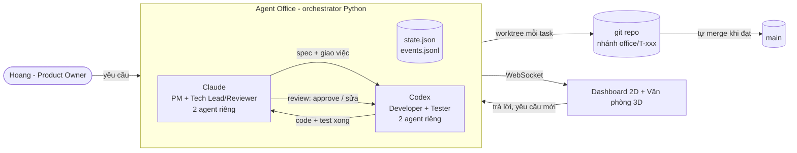

# Tài liệu SportsCut AI

Bộ tài liệu tổng hợp mọi kỹ thuật dùng trong dự án: cách dựng một "văn phòng" nhiều agent AI tự
giao việc cho nhau, văn phòng 3D để quan sát, và công nghệ cắt highlight của sản phẩm SportsCut.

| # | Tài liệu | Đọc khi |
|---|---|---|
| 1 | [Kiến trúc multi-agent và cách giao việc](01-multi-agent.md) | Hiểu bốn vai (PM, Tech Lead, Developer, Tester) trên Claude và Codex phối hợp thế nào từ yêu cầu tới merge |
| 2 | [Quota, chạy song song, rào chắn](02-quota-song-song-rao-chan.md) | Chạy bằng gói thuê bao, tăng tốc, giữ an toàn |
| 3 | [Kỷ luật kỹ thuật và cổng chất lượng](03-ky-luat-ky-thuat.md) | Superpowers, TDD, bằng chứng, eval, spec lưu trong repo |
| 4 | [Văn phòng 3D và dashboard](04-van-phong-3d.md) | Kiến trúc realtime, rendering, demo |
| 5 | [Công nghệ cắt highlight SportsCut](05-sportscut.md) | Tín hiệu nhận diện highlight, đo độ chính xác |
| 6 | [Code đã implement thế nào](06-code-implementation.md) | Module, luồng dữ liệu, test, điểm mở rộng |
| 7 | [Áp dụng cho dự án khác](07-ap-dung-du-an-moi.md) | Bàn giao, dựng văn phòng agent cho repo mới |
| 8 | [Công nghệ sử dụng](08-cong-nghe.md) | Tra nhanh công cụ và lý do chọn |
| 9 | [Vận hành và xử lý sự cố](09-van-hanh.md) | Lệnh, sự cố thường gặp, log ở đâu |

## Bức tranh tổng

Nguyên tắc xuyên suốt:

1. **Không dùng API key.** Agent chạy bằng CLI đăng nhập gói thuê bao (`claude -p`, `codex exec`).
2. **Agent tự làm tới khi có kết quả.** Chỉ hỏi PO khi yêu cầu thật sự chưa rõ.
3. **Mọi thứ đều có trạng thái lưu trên đĩa.** Hết quota, tắt máy, crash đều tiếp tục được.
4. **Đo trước, tối ưu sau.** Chất lượng sản phẩm là một con số (F1), không phải cảm giác.
